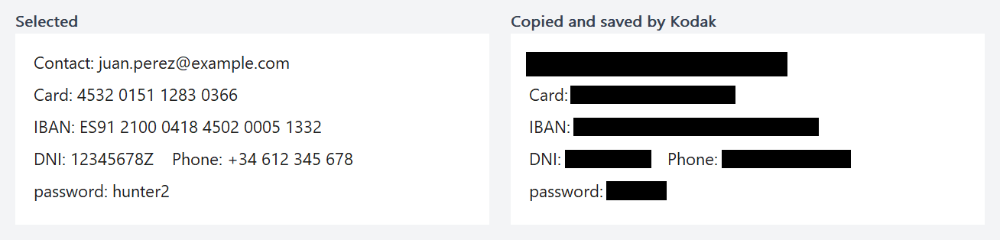

# Kodak

[](https://github.com/deathface0/Kodak/actions/workflows/ci.yml)
[](LICENSE)

Screenshots for Windows that redact sensitive data before they leave your computer.

Press a shortcut, select part of the screen, and Kodak proposes what to cover: e-mail addresses, card numbers,
IBANs, DNI/NIE numbers, phone numbers, IP addresses, API keys and passwords. You review the proposals, add your
own boxes, and only the redacted image reaches the clipboard and the PNG file.

**Everything happens on your computer.** Text is read with the OCR built into Windows; nothing is uploaded,
there are no accounts and no telemetry.



<!-- A short screen recording of a capture can go here as docs/img/demo.gif
     (for example recorded with ScreenToGif: shortcut, selection, review, Enter, paste). -->

## Features

- **Frozen capture** of every monitor, in physical pixels, at any scaling: what you select is exactly what you saw.
- **Proposals for sensitive text**, found by validated rules rather than guesses: Luhn for cards, mod 97 for IBANs,
  the control letter of DNI/NIE numbers, known API key formats, random-looking tokens, values after labels such as
  `password:`, and terms of your own (your name, your address).
- **Mandatory review**: proposals start on, a click turns one off, you can draw your own boxes, and nothing is
  copied until you confirm.
- **Solid boxes on the pixels**: text is never blurred or pixelated, which can be reversed.
- **Clean output**: the clipboard (bitmap and PNG) and a new PNG in `Pictures\Kodak` with no metadata; the
  original capture is wiped from memory.

## Using it

Kodak lives in the notification area. Press **Ctrl+Shift+X** (or pick *Capture* from its icon menu):

1. **Drag** to select an area. Esc or a right click cancels.
2. Kodak **looks for sensitive text** in it and proposes black boxes with an amber outline, also listed beside the
   selection with a masked preview (`ju***@gmail.com`).
3. **Review**:
   - click a proposal, on the image or in the list, to turn it off or on (off = dashed outline, left visible);
   - drag inside the selection to add a box of your own; right-click a box, or press Backspace or Ctrl+Z, to remove it;
   - drag outside the selection to start again.
4. **Enter** or a **double-click** copies the redacted image and saves it. If the analysis is still running, Kodak
   saves as soon as it finishes.

## What it looks for

| Data | Example | Checked with |
| --- | --- | --- |
| E-mail address | `juan.perez@example.com` | a domain with a real-looking extension |
| Card number | `4532 0151 1283 0366` | Luhn checksum |
| IBAN | `ES91 2100 0418 4502 0005 1332` | mod-97 check digits, length by country |
| DNI / NIE | `12345678Z`, `X1234567L` | control letter |
| Phone number | `+34 612 345 678` | Spanish format |
| IP address | `192.168.1.20` | four octets from 0 to 255 |
| Secret | `AKIA...`, `ghp_...`, `AIza...`, `sk_live_...`, JWTs, private key headers, random-looking tokens | format or entropy |
| Labelled value | `password: hunter2`, `PIN = 1234`, `Contrase&ntilde;a: ...` | the label |
| Your own terms | your name, your address | exact text, ignoring case and accents |

## Settings

*Settings...* in the icon menu sets the shortcut, whether a PNG is also saved, which data to look for and your own
terms. Changes apply at once. They are stored in `%APPDATA%\Kodak\settings.json`, which can also be edited by
hand (comments are allowed; a broken file is never overwritten, Kodak warns and uses the defaults).

## Limitations

The proposals are help, not a guarantee: **always review before sharing.**

- The OCR can miss text: very small or low-contrast text, unusual fonts, or lines it takes for noise (for example
  long runs of the digit 1). What it does not read is not proposed; cover it with your own box.
- Text recognition needs a Windows language with OCR installed (*Settings > Time & language > Language*). Without
  one, Kodak says so and manual boxes still work.
- Kodak covers whole words: a match inside a longer word, or a label read together with its value, is covered with
  the rest of that word.

## Install

Download `kodak-<version>-win64.zip` from [Releases](https://github.com/deathface0/Kodak/releases), unzip it
anywhere and run `kodak.exe`. It needs Windows 10 or later and nothing else.

## Building

Requires CMake 3.21+ and Visual Studio 2022 (MSVC). On Linux only `kodak_core` and its tests build.

```
cmake --preset msvc
cmake --build --preset msvc-release
ctest --preset msvc-release
```

The executable is `build/msvc/app/Release/kodak.exe`.

| Directory | CMake target | Contents |
| --- | --- | --- |
| `core/` | `kodak_core` | Plain C++ (no Windows headers): images, geometry, text rules, detection, redaction, settings |
| `win/` | `kodak_win` | Everything that talks to Windows: capture, OCR, PNG and clipboard, files, hotkey, tray |
| `app/` | `kodak` | The executable: overlay and review, tray menu, settings window; `res/` holds the resources |
| `tests/` | `kodak_core_tests`, `kodak_win_tests` | doctest unit tests; `tests/core/` also runs on Linux |

Public headers live in `<dir>/include/kodak/<layer>/`, sources in `<dir>/src/`. Version 1 is kept under the
[`v1.0`](https://github.com/deathface0/Kodak/tree/v1.0) tag; see the [changelog](CHANGELOG.md) for what changed.

## License

[MIT](LICENSE)
